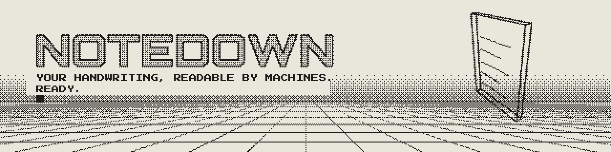
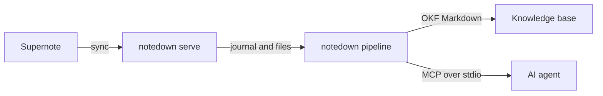

<picture>
  <source media="(prefers-reduced-motion: reduce)" srcset="docs/assets/banner-static.png">
  
</picture>

# notedown

**Your handwriting, readable by machines.**

[](https://github.com/jordiboehme/notedown/actions/workflows/ci.yml)
[](LICENSE)
[](https://github.com/jordiboehme/crystalline)

You write on a Supernote. Your AI agent reads Markdown. notedown sits in between.

It reads `.note` files (and PNG pages), runs a local OCR model on every page and writes Markdown. A
drawn diagram becomes a Mermaid block, links between notes stay links, and digests and keywords end
up in the front matter. Nothing leaves your machine.

notedown can also be the Private Cloud of your Supernote. Clouds? Where we're going, we don't need
someone else's cloud. Your device syncs with a small server at home, every change lands in a journal,
and a pipeline turns new pages into text while you still hold the pen. Agents read that text over MCP.

One Rust binary. Local OCR with Metal on a Mac. No accounts at a vendor, no telemetry.

notedown is for Supernote devices and is not affiliated with Ratta.

## Status

What works today:

- `convert` and `render`: `.note` files to Markdown and PNG.
- The Private Cloud: device sync, digests, to-dos, a recycle bin and a journal.
- The pipeline: keeps the note text up to date and serves it to agents over MCP (stdio).

The sync server also builds for a Raspberry Pi without the OCR part (see the [getting started guide](docs/getting-started.md#the-server-on-a-raspberry-pi)).

What comes next: a pipeline on a Mac that reads the server on the Pi, and a new vision engine
that reads layout and content in two steps. There is no release yet, so you build it from source.
Star the repo if you want to see where this goes.

## Quick start

```sh
cargo install --path crates/notedown
notedown model pull                       # once, about 3.4 GB
notedown convert ~/Supernote/Note --out ~/notes-md
```

notedown can also be the Private Cloud of your Supernote. Back up the device, fill the cloud with the
backup and the digests from the device's own `.snbak` backup, start the server and log in on the
device:

```sh
notedown cloud account --data ~/notedown-data add me --email you@example.org
notedown cloud backup-device http://<device ip>:8089 ~/supernote-backup
notedown cloud import ~/supernote-backup --data ~/notedown-data --account me
notedown cloud import-app-data Supernote_<date>_<time>.snbak --data ~/notedown-data --account me
notedown serve --data ~/notedown-data
```

On the device, log out of Ratta's cloud and **always choose "Retain locally"**. Then log in to the
Private Cloud with the `device URL` that the server prints, and select the folders to sync.

Don't skip a step here: a cloud that misses files makes the device delete them. The
[getting started guide](docs/getting-started.md) describes every step, with the backup, the first
sync and the way back.

## Install

There is no release yet. Build it from source with the Rust toolchain that `rust-toolchain.toml`
names (rustup picks it up by itself):

```sh
git clone https://github.com/jordiboehme/notedown.git
cd notedown
cargo install --path crates/notedown
```

Homebrew comes with the first release.

On macOS the model runs on the GPU with Metal automatically. On Linux the build needs `cmake` and a C++
compiler, and inference runs on the CPU.

Then download the OCR model once (about 3.4 GB, checked against pinned SHA-256 sums):

```sh
notedown model pull
```

The files go to `~/Library/Caches/notedown/models` on macOS and `$XDG_CACHE_HOME/notedown/models` on
Linux. Set `NOTEDOWN_MODEL_DIR` to use another folder. `notedown model path` shows the paths and
`notedown model verify` checks the files.

## Usage

```sh
# one file, the Markdown file is written next to it
notedown convert "Test 2.note"

# a whole folder, searched recursively, written under another folder
notedown convert ~/Supernote/Note --out ~/notes-md

# also save the page images and link them in the Markdown
notedown convert "Test 2.note" --images

# also write <name>.debug.json with the raw OCR output and metadata
notedown convert "Test 2.note" --debug

# only render the pages as PNG images (no OCR)
notedown render "Test 2.note" --out pages
```

`render` writes `<name>-page-001.png`, `<name>-page-002.png` and so on. The template (ruled lines or
grid) is left out because it confuses OCR; add `--keep-template` to keep it, in `render` and in
`convert`.

Other `convert` options: `--force`, `--model GGUF`, `--mmproj GGUF`, `--max-tokens N` (default 4096),
`--threads N` and `--allow-unknown-version`.

### Skipping and overwriting

A file is skipped when its `.md` already exists and the front matter has the same source checksum, the
same model and the same notedown major version. The model is not even loaded when every file is
skipped.

A `.md` file from an older notedown has a front matter without `type`. When its source checksum, model
and major version still match, notedown only replaces the front matter with the new one and keeps the
text below it byte for byte. No OCR runs for this and the model isn't loaded. The run prints "updated
the header of ..." for each such file. `generated` keeps the old version and time, `source_date` and
`last_modified` come from the source file as it is now.

The same header-only update runs when the text is current but the source file moved or only its time
changed, so `resource`, `source_date` and `last_modified` are right again. A header-only update keeps
the links in the old text as they are. Use `--force` to convert the file again and rewrite them.

Other tools may change the front matter of a converted file, for example Crystalline when it writes the
note back or adds a `verified` key. notedown still knows the file as its own as long as `generated.by`
starts with `notedown/`. Keys that notedown doesn't know are kept and written after its own keys when
notedown writes the file again, together with comment lines. notedown's own keys (like `tags` or
`title`) get notedown's values again. A file with CRLF line endings keeps them.

notedown never overwrites a `.md` file it did not write itself. Such a file counts as a failure (exit
code 1) and the error is printed.

`--force` does both: it converts files that are up to date again, and it replaces a `.md` file that
notedown did not write.

When notedown searches a folder, it skips what it writes itself: `<name>.assets/` folders, the `--out`
folder and `<name>-page-NNN.png` images next to `<name>.note`. Hidden files and symbolic links to
folders are skipped too.

One failing file does not stop the run. The exit code is 1 if any file failed and 2 for wrong usage.

## Output format

Every `.md` file is a concept document of the
[Open Knowledge Format](https://github.com/GoogleCloudPlatform/knowledge-catalog/tree/main/okf) (OKF
v0.2), so a folder of converted notes is an OKF bundle. Crystalline reads it as it is.

```markdown
---
type: note
title: "Test 2"
description: "Handwritten Supernote note, 1 page, read by OCR."
resource: "Test 2.note"
tags: [supernote]
generated: { by: notedown/0.1.0, model: "chandra-ocr-2 Q4_K_M", at: 2026-10-05T23:10:00Z }
source_date: 2026-10-05
sources:
  - { id: note, resource: "Test 2.note", last_modified: 2026-10-05T22:55:35Z }
status: stable
source_sha256: "<hex>"
file_id: "F20261005225535133622IHP5FqtIJoxD"
pages: 1
keywords: []
links:
  - { page: 1, target_file_id: "F20240708174639550429bHksqaP2wKQ8", target_path: "/storage/emulated/0/Note/Bike.note", target_md: "Bike.md" }
---

<a id="page-1"></a>
## Page 1
<!-- page_id: P20261005225535142460xFi05hBOdWD6 -->


This note is without real-time recognition.

Links: [Bike](Bike.md)
```

The keys of the front matter:

- `type` is always `note`, also for a PNG page.
- `title` is the name of the source file without its extension.
- `description` says what the file is: a note with its number of pages, or a single PNG page.
- `resource` is the source file, relative to the folder of the `.md` file. It works with and without
  `--out`, and also when `--out` is a symbolic link.
- `tags` is always `[supernote]`.
- `generated` says who wrote the text and when: `by` is notedown with its version, `model` the OCR
  model and `at` the time of the conversion in UTC.
- `source_date` is the day the source file was last changed, in local time.
- `sources` names the source file once more, with `last_modified`, the time it was last changed in
  UTC. When that time can't be read, `source_date` and `last_modified` are left out.
- `status` is `draft` when a page hit the token limit and its text may be cut off. Otherwise it's
  `stable`.
- `source_sha256` is the checksum of the source file. notedown uses it to skip files that didn't
  change.
- `file_id` is the `FILE_ID` of the note. A PNG page has none.
- `pages` is the number of pages.
- `keywords` lists the keywords of the note as `p<page>: <text>`.
- `links` and `digests` are described below.

OKF reserves the names `index.md` and `log.md`. A source named `index` or `log` (in any case) keeps its
extension in the name of the `.md` file: `index.note` becomes `index.note.md` and `Log.png` becomes
`Log.png.md`. Links to such a note use that name. An `index.md` or `log.md` that an older notedown
wrote for the same note stays where it is and is no longer updated. The run prints a warning that names
it, so you can delete it.

Text values are written in double quotes, so no YAML reader takes a name like `2024` or `yes` for a
number or a yes/no value. Dates, times and numbers are written without quotes.

Every page starts with an `<a id="page-N"></a>` anchor, so links to a page inside the same note work
as `#page-N`. The image line and the `<name>.assets/` folder appear only with `--images`. A page that
hit the token limit gets `<!-- notedown: truncated -->`. Drawn diagrams that the model reads as Mermaid
become `mermaid` code blocks, followed by the model's description of the diagram as a `>` blockquote.
A drawing that is not a diagram becomes a `> Figure: ...` blockquote.

Links to other notes are listed in a `Links:` line at the end of the page. `links:` in the front
matter keeps each link to another note: `target_file_id` is the `FILE_ID` of the target note,
`target_path` its path on the device and `target_md` the generated Markdown file, relative to this
one. `target_md` is missing when the target note was not converted (yet); the `Links:` line then shows
the name and the device path instead of a link.

A note digest is a text box that the Supernote device created from selected handwriting and linked to
a digest. `digests:` in the front matter lists each such text box: `page` (1-based), `digest_id`,
the `text` of the box and its `rect` as `left,top,width,height` in page pixels. The text is also
part of the page text from the OCR, so the Markdown body does not change. The annotation of the digest
itself is stored outside the `.note` file and is not available to notedown. The key is left out when
a note has no digests.

## Private Cloud

notedown can run a small server that the Supernote Nomad accepts as its Private Cloud. It stores your
files as real files in a data folder and writes every change to a journal.

- Protect mode is on by default. The server refuses every file request until `notedown cloud import`
  has filled the account, and it keeps a recycle bin for every delete and overwrite.
- The server prunes the recycle bin about once an hour while it runs. For each file it keeps the 3
  newest old versions, the version the file had at the end of each of the last 7 days and at the end
  of each of the last 12 months. A deleted file's versions are removed 90 days after the delete. See
  `server.toml` and `notedown cloud recycle prune --dry-run`.
- `notedown cloud put` adds a file from the computer. notedown then tells the connected devices to sync.
  With "Auto Sync" on, the file usually arrives a few seconds later. If it doesn't, start a manual sync.
- `notedown cloud journal tail` prints the changes as JSON lines.
- `notedown serve --refuse-sync` refuses every sync and exchanges no files. It's for recording the
  protocol only.
- Digests (with groups and handwritten comments) and to-dos sync too. They're stored as JSON files
  and every change goes to the journal. `notedown cloud import-app-data` fills the digests from the
  device's `.snbak` backup first (the backup holds no to-dos). Until then the device shows "App Data
  Sync Failed" and only the files sync.

Read the [getting started guide](docs/getting-started.md) before you switch a device. It covers the
backup, the import, the first sync, daily use, the way back and troubleshooting. The protocol is
documented in `docs/sync-protocol.md`.

## Format documentation and tests

The `.note` format is documented in `docs/note-format.md`. The parser in `crates/notedown-note` is a
clean-room implementation of that document. The golden test renderings are generated by supernotelib
through `scripts/reference.sh`; it is used only as a test tool.

## How it fits



The Markdown follows the frontmatter conventions of [Crystalline](https://github.com/jordiboehme/crystalline),
so your notes become knowledge your agents can search, link and build on. Office files and PDFs go
through [Rezzer](https://github.com/jordiboehme/rezzer), the same way.

## Principles

- **Local first.** OCR runs on your machine. Your notes never go to a vendor's cloud, ours included (there is none).
- **Never lose a note.** A network error or a missing folder means "nothing known", never "deleted". Every delete and overwrite goes to a recycle bin first.
- **Honest output.** A page that hit the token limit is marked as a draft. A drawing that isn't a diagram says so.
- **One binary.** No Python environment, no helper programs.

## Security

`notedown serve` speaks plain HTTP on your home network, like the Supernote expects. Don't expose it
to the internet directly. Found a problem? Please report it privately, see [SECURITY.md](SECURITY.md).

## Support

notedown is free and open source. If it earned its place next to your pen, you can support or sponsor
the work here:

[](https://ko-fi.com/V7V31T6CL9)
[](https://paypal.me/jordiboehmelopez)

Missing a feature for your Supernote workflow? [Open an issue](https://github.com/jordiboehme/notedown/issues)
and let's talk.

## License

notedown is licensed under AGPL-3.0-or-later, see `LICENSE`.

The OCR model is Chandra OCR 2 by Datalab. notedown downloads the weights on request and does not ship
them. They are under a modified OpenRAIL-M license: free for personal use and for organisations under 2
million USD revenue. See the model card for the exact terms.
