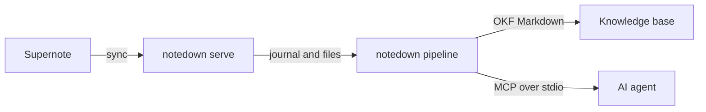
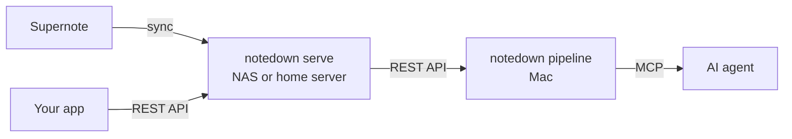

<picture>
  <source media="(prefers-reduced-motion: reduce)" srcset="docs/assets/banner-static.png">
  
</picture>

# Notedown

**Ink in. Markdown out. Agents welcome.**

[](https://github.com/jordiboehme/notedown/actions/workflows/ci.yml)
[](LICENSE)
[](https://github.com/jordiboehme/crystalline)

You write on a Supernote. Your AI agent reads Markdown. Notedown sits in between.

Notedown reads your handwriting with a local OCR model and writes Markdown. It can also be the
Private Cloud your Supernote syncs with, and it gives the note text to your AI agent. It's for people
who think with a pen and want their notes to stay on their own machine.

A Mac app around one Rust binary. No accounts at a vendor, no telemetry. Notedown is for Supernote
devices and is not affiliated with Ratta.

## Get started

You need a Mac with Apple Silicon and macOS 13 or later. Install the app with [Homebrew](https://brew.sh):

```sh
brew install --cask jordiboehme/tap/notedown-app
```

Or download `notedown-app-v<version>-macos.dmg` from the [releases page](https://github.com/jordiboehme/notedown/releases/latest),
open it and drag Notedown into Applications. [Install](docs/install.md) has the details.

Then open Notedown in the menu bar and go to Settings, Setup. Setup walks you through it, without the
terminal: the server, the account, the OCR model (about 3.6 GB), the backup and import of your
Supernote, the first sync and your agent.

Take your time with the backup. **Never write on the Supernote between the backup and the first
sync.** A file that is missing on the server gets deleted on the Supernote. The app refuses an old
backup for that reason.

## What you get

- **Handwriting to Markdown.** Every page of a `.note` file becomes text, read by a local OCR model.
  A drawn diagram becomes a Mermaid block. Digests and keywords land in the front matter.
- **Your own Private Cloud.** Clouds? Where we're going, we don't need someone else's cloud. Your
  Supernote syncs with a small server at home. Your files stay real files in a folder, every change
  lands in a journal and every delete and overwrite goes to a recycle bin first.
- **A menu bar app.** One click shows when the Supernote last synced, how much OCR is left and what
  your agent read. The library shows every folder of the Supernote. Drop files from Finder into it,
  move and rename them and get them back from the recycle bin. Open a note to see its handwritten
  pages next to its Markdown.
- **Note text for your AI agent.** New pages turn into text while you still hold the pen. Agents read
  it over MCP.
- **Everything local.** OCR runs with Metal on your Mac. Nothing leaves your machine.



The Markdown follows the frontmatter conventions of [Crystalline](https://github.com/jordiboehme/crystalline),
so your notes become knowledge your agents can search, link and build on. Office files and PDFs go
through [Rezzer](https://github.com/jordiboehme/rezzer), the same way.

Next: a new vision engine that reads layout and content in two steps. Star the repo if you want to
see where this goes.

## Run it in your homelab

Want a more professional setup? The sync server is small and runs on any machine that is always on:
a NAS, a Raspberry Pi, an Intel box or any other home server (Linux on 64-bit Arm or x86_64). Your
Supernote then syncs with the server even when your Mac sleeps. The Mac reads the new pages over the
server's REST API and keeps the note text for your agent.



On the server, use one of these. The Linux builds have no OCR: they have `serve`, `cloud` and `render`.

- **The `.deb`** for Debian, Ubuntu and Raspberry Pi OS (arm64 and amd64). It comes with a systemd
  service.
- **The container image** `ghcr.io/jordiboehme/notedown` for linux/amd64 and linux/arm64.

[Install](docs/install.md) shows both, and how to set up the account and the import there.

On the Mac, choose Remote in Setup and log in. The same password also connects the OCR. Without the
app, `notedown connect` does the same (see the command line below).

Give the server a fixed address (a fixed lease in your router or a static address): the device keeps
the address of its Private Cloud. Both machines need the right time (NTP). The details are in the
guide: [the server on another machine](docs/getting-started.md#the-server-on-another-machine) and
[a pipeline on a Mac](docs/getting-started.md#a-pipeline-on-a-mac).

Building an app? The same [REST API](docs/rest-api.md) lets it browse, upload, rename, move and
delete the files of an account.

## Advanced: the command line

The app runs the `notedown` command line tool for you. You can also use it on its own:

```sh
brew install jordiboehme/tap/notedown
```

Or download it from the [releases page](https://github.com/jordiboehme/notedown/releases/latest), see
[Install](docs/install.md). To build it from source you need the Rust toolchain ([rustup](https://rustup.rs)):

```sh
# rustup picks the right toolchain by itself
git clone https://github.com/jordiboehme/notedown.git
cd notedown
cargo install --path crates/notedown
```

Then:

```sh
# download the OCR model once (about 3.6 GB)
notedown model pull

# turn a folder of notes into Markdown
notedown convert ~/Supernote/Note --out ~/notes-md
```

That's it for Markdown. Run `convert` again later: notes that didn't change are skipped.

**Your Mac as the Private Cloud.** Notedown can also be the cloud your Supernote syncs with, and it
reads every new page while it runs. Fill the cloud with a backup of the device first: a cloud that
misses files makes the device delete them.

Every command that takes `--data` uses `$NOTEDOWN_DATA` when you leave it out, or `~/notedown-data` when that is not set.

```sh
# an account for the device to log in with
notedown cloud account --data ~/notedown-data add me --email you@example.org
# back up the device (turn on "Browse & Access" on the device first)
notedown cloud backup-device http://<device ip>:8089 ~/supernote-backup
# fill the cloud with the backup and the digests from the device's own .snbak backup
notedown cloud import ~/supernote-backup --data ~/notedown-data --account me
notedown cloud import-app-data Supernote_<date>_<time>.snbak --data ~/notedown-data --account me
# start the server and the pipeline that turns new pages into text
notedown serve --data ~/notedown-data --pipeline
```

On the device, log out of Ratta's cloud and **always choose "Retain locally"**. Then log in to the
Private Cloud with the `device URL` that the server prints, and select the folders to sync.

Give the note text to your agent, for example Claude Code:

```sh
claude mcp add notedown -- notedown mcp --data ~/notedown-data
```

With the server on another machine, connect the Mac to it instead:

```sh
# log in once, keeps a read-only token and writes pipeline.toml
notedown connect http://<server>:19072 --data ~/notedown-mac --email you@example.org
# read the new pages as text
notedown pipeline --data ~/notedown-mac
# give the text to your agent
claude mcp add notedown -- notedown mcp --data ~/notedown-mac
```

Don't skip a step here. The [getting started guide](docs/getting-started.md) describes every step:
the backup, the import, the device login, the first sync, daily use and the way back.

## Go deeper

- [Getting started](docs/getting-started.md): the full guide, from the first note to a Supernote that syncs with Notedown.
- [Reference](docs/reference.md): install details, every `convert` and `render` option, [skipping and overwriting](docs/reference.md#skipping-and-overwriting), the [output format](docs/reference.md#output-format) and the [Private Cloud](docs/reference.md#private-cloud) in short.
- [REST API](docs/rest-api.md): every route for apps and for the pipeline on a Mac.
- [Sync protocol](docs/sync-protocol.md): how the device talks to its cloud, and the files and journal on disk.
- [Note format](docs/note-format.md): the `.note` file format, as the parser reads it.

## Principles

- **Local first.** OCR runs on your machine. Your notes never go to a vendor's cloud, ours included (there is none).
- **Never lose a note.** A network error or a missing folder means "nothing known", never "deleted". Every delete and overwrite goes to a recycle bin first.
- **Honest output.** A page that hit the token limit is marked as a draft. A drawing that isn't a diagram says so.
- **One binary.** No Python environment, no helper programs.

## Security

`notedown serve` speaks plain HTTP on your home network, like the Supernote expects. Don't expose it
to the internet directly. Found a problem? Please report it privately, see [SECURITY.md](SECURITY.md).

## Support

Notedown is free and open source. If it earned its place next to your pen, you can support or sponsor
the work here:

[](https://ko-fi.com/V7V31T6CL9)
[](https://paypal.me/jordiboehmelopez)

Missing a feature for your Supernote workflow? [Open an issue](https://github.com/jordiboehme/notedown/issues)
and let's talk.

## License

Notedown is licensed under AGPL-3.0-or-later, see `LICENSE`.

The one exception is the `notedown-ocr` crate. Since 0.2.0 it is licensed under MPL-2.0, see
`crates/notedown-ocr/LICENSE`. Versions released before keep the licence they had.

The OCR uses four model files. Notedown downloads them on request and does not ship them. It shows
their licences before the download starts:

- Qwen3.5-4B (Qwen team, Alibaba Cloud): Apache-2.0
- PP-DocLayoutV3 and PP-OCRv6 (PaddlePaddle Authors): Apache-2.0
